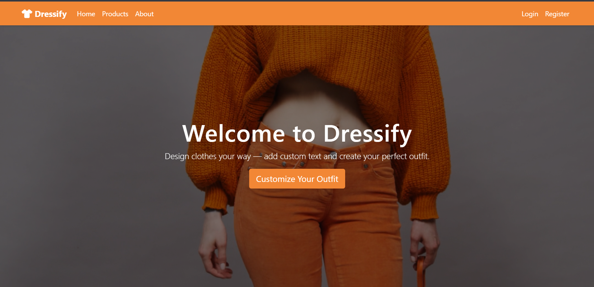
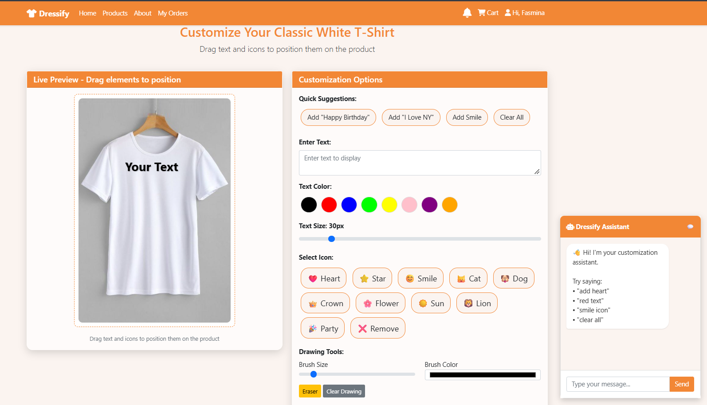
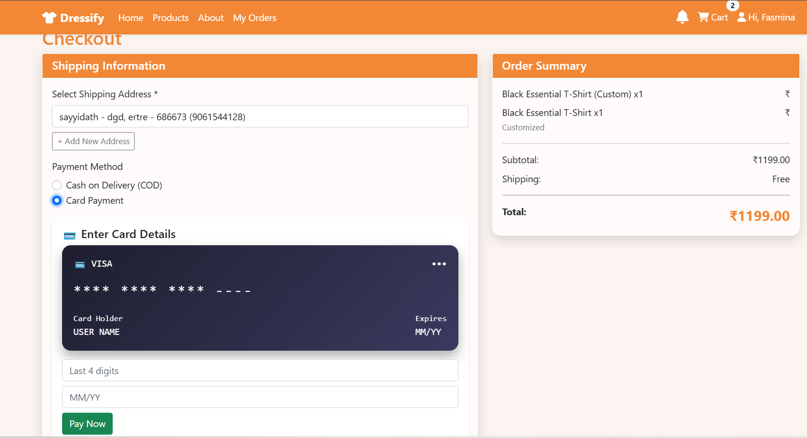
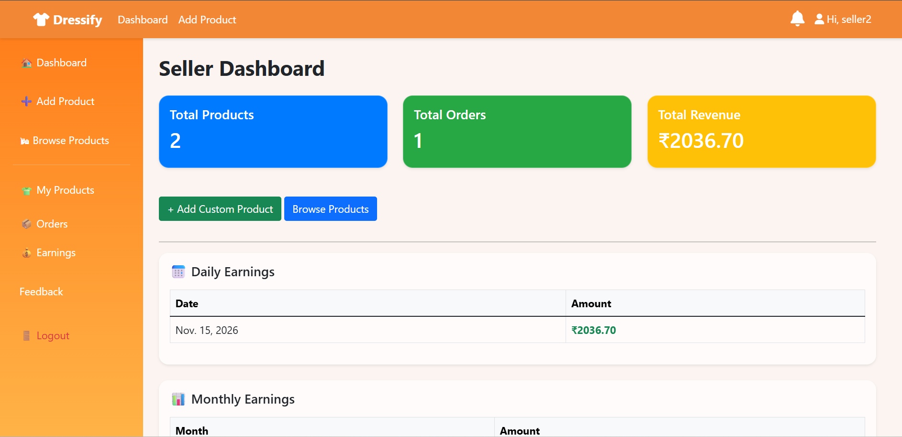
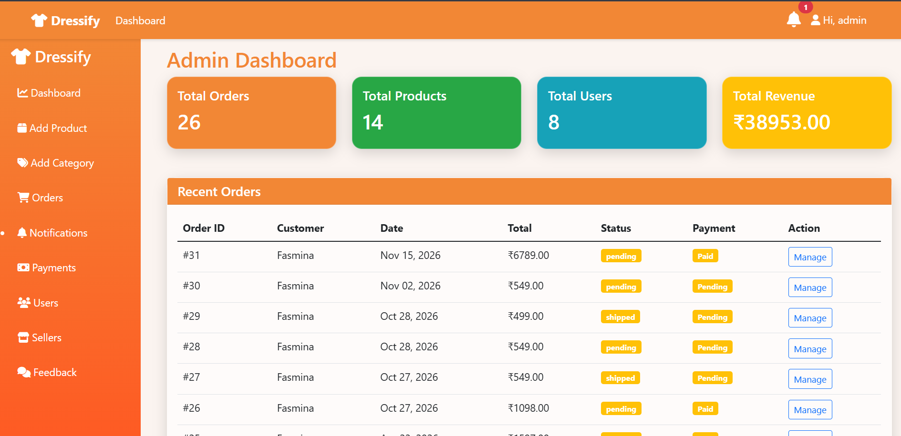

# Dressify - Customizable Clothing Platform

A Django e-commerce platform where customers can buy ready-made clothing or design their own, and sellers create designs from admin products and earn a commission on every sale.

## Features

### Customers
- Browse products by category and search
- **Buy plain products directly:** add to cart or use Buy Now, with no customization needed
- **Or customize before buying (+₹50):** design editor to add text, drag and position text and emoji icons, change colors and size, and draw freehand with a brush and eraser, with a live preview
- **Chatbot assistant:** simple rule-based helper for quick commands such as "add heart" or "red text"
- Cart with quantity controls and saved delivery addresses
- **Checkout with two payment options:**
  - Cash on Delivery
  - Online payment (demo): validates the card's last 4 digits and expiry date, shows an error for an expired card, and shows a "payment successful" message. No real money is processed.
- Order history with **courier tracking** (DTDC and India Post tracking links using the tracking ID)
- Notifications, feedback and ratings

### Sellers
- Seller registration with ID proof upload, **approved by the admin** before the seller can log in
- Customize admin products and set their own selling price
- Add admin products to their own shop
- Earn a **30% commission** on each sale of their products (the admin keeps 70%)
- Dashboard with total orders, daily and monthly earnings and customer feedback
- Sellers only showcase their designs. The admin ships the orders.

### Admin
- Add categories and products
- Manage orders: update status, courier and tracking ID
- Approve or reject seller applications and manage users
- View payments, feedback and sales statistics
- Receive notifications for new orders and seller registrations

## Tech Stack
- **Backend:** Python, Django
- **Frontend:** HTML, CSS, JavaScript, Bootstrap 5
- **Database:** SQLite
- **Libraries:** Pillow, html2canvas, Font Awesome

## Screenshots






## How to Run Locally
Requires Python 3.12 or newer.

1. Clone the repository:
   ```
   git clone https://github.com/Sayyidath719/dressify-custom-clothing.git
   cd dressify-custom-clothing
   ```
2. Install dependencies:
   ```
   pip install -r requirements.txt
   ```
3. Create the database:
   ```
   python manage.py migrate
   ```
4. Create an admin account:
   ```
   python manage.py createsuperuser
   ```
5. Start the server:
   ```
   python manage.py runserver
   ```
6. Open `http://127.0.0.1:8000/`. Log in at `/admin/` to add categories and products (tick `is_featured` to show a product on the home page).

## Notes
- Product images and uploaded files are not included, so add your own through the admin panel.
- The `SECRET_KEY` in `settings.py` is for local development only.
- Built using AI-assisted development tools, with a focus on understanding Django models, views, templates and URL routing.

## Future Improvements
- Add permission checks to all admin views
- Integrate a real payment gateway
- Move to PostgreSQL and add automated tests

## Author
Sayyidath Aysha Shibila KP, BCA (AI Add-on) graduate
